# Інструкція: Тендери та Фільтри

Ця інструкція пояснює, як знаходити потрібні закупівлі в Prozorro Search, як перевіряти пошукові гіпотези й зберігати пошуки як фільтри.

## 1. Вхід і робочий простір

Увійдіть з email і паролем.

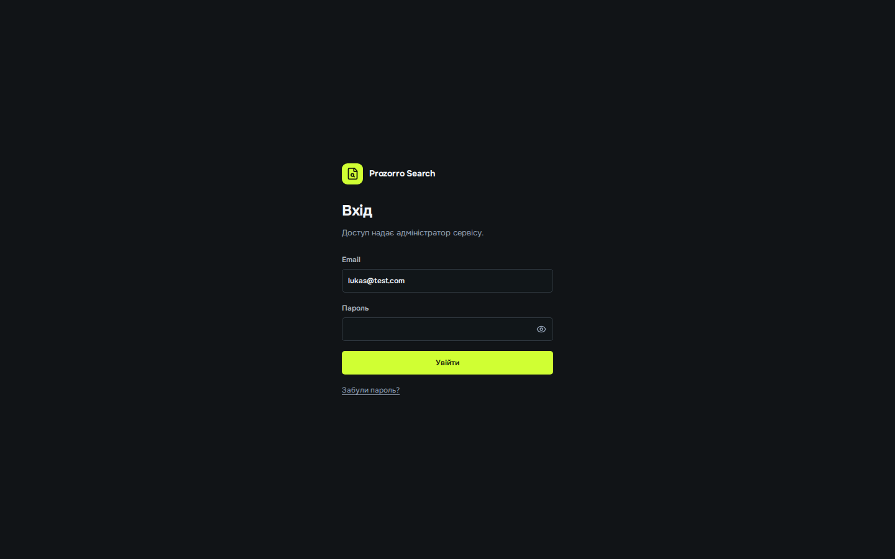

Після входу ліворуч є меню з двома розділами:

| Розділ | Для чого |
|---|---|
| **Тендери** | Пошук закупівель, перевірка гіпотез, збереження фільтрів |
| **Фільтри** | Список фільтрів: відкрити, перейменувати, скопіювати, видалити |

Кожна відкрита сторінка (зокрема картка тендера) з'являється вкладкою вгорі, як у браузері. Вкладки зберігаються між входами. Повернення на вкладку «Тендери» відновлює останній пошук.

## 2. Сторінка «Тендери»

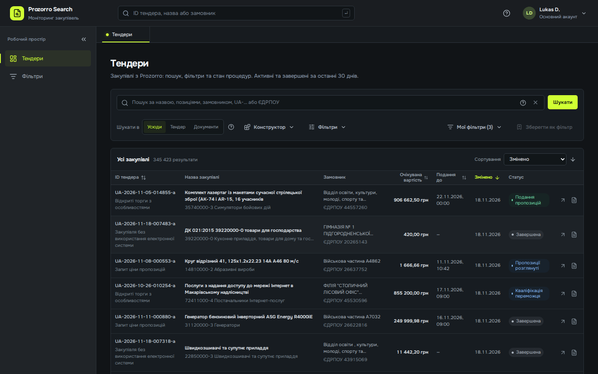

Каталог показує закупівлі, активні та завершені за останні 30 днів. Без пошуку їх 345 тис., і найсвіжіші зміни показано першими.

Що є на сторінці:

1. **Поле пошуку** і кнопка **«Шукати»**. Enter запускає пошук, Shift+Enter переносить рядок (запит може бути довгим).
2. **«Шукати в»** — де шукати слова: **Усюди**, лише в **Тендері** або лише в **Документах**.
3. **«Конструктор»** — збирає запит з полів без знання синтаксису.
4. **«Фільтри»** — статус, процедура, регіон, ДК021, замовник, сума, дати.
5. **«Мої фільтри»** і **«Зберегти як фільтр»** — робота зі збереженими пошуками.
6. **«Очистити все»** скидає запит і всі фільтри.
7. **Таблиця**: ID, назва, замовник, очікувана вартість, кінець подання пропозицій, дата зміни, статус. Праворуч є кнопки: відкрити тендер на Prozorro і відкрити картку.

### Сортування і сторінки

- Список **«Сортування»**: за релевантністю (лише коли є запит), змінено, оголошено, очікувана вартість, подання до, ID. Стрілка поруч змінює напрямок. Заголовки колонок теж сортують таблицю.
- Коли ви щось шукаєте, тендери за замовчуванням впорядковано **за релевантністю**: вище ті, де слова є в назві.
- Внизу можна вибрати 10, 25, 50 або 100 рядків на сторінку і перейти на іншу сторінку. Наступна сторінка завантажується заздалегідь, тож гортати можна без очікування.

### Клавіатура

Клацніть рядок таблиці, а далі:

| Клавіша | Дія |
|---|---|
| ↑ / ↓ | Попередній / наступний рядок |
| Space | Розгорнути або згорнути збіги рядка |
| Enter | Відкрити картку тендера |

### Посилання на пошук

Запит, фільтри, сортування й сторінка зберігаються в адресі сторінки. Скопіюйте адресу, щоб надіслати колезі такий самий пошук. Колега побачить ті самі умови.

## 3. Як працює пошук

### Де шукаються слова

Пошук іде в назві, описі, позиціях, лотах, назві замовника, описі класифікатора ДК021 і (у режимі «Усюди») у тексті документів тендера.

Особливі запити:

| Запит | Що знайде |
|---|---|
| `UA-2026-10-26-002938-a` | Тендер за ID (можна вводити початок ID) |
| `44127746` (8 цифр) | Усі тендери замовника з таким ЄДРПОУ |

### Синтаксис

Кнопка **«?»** у полі пошуку показує коротку довідку з синтаксису.

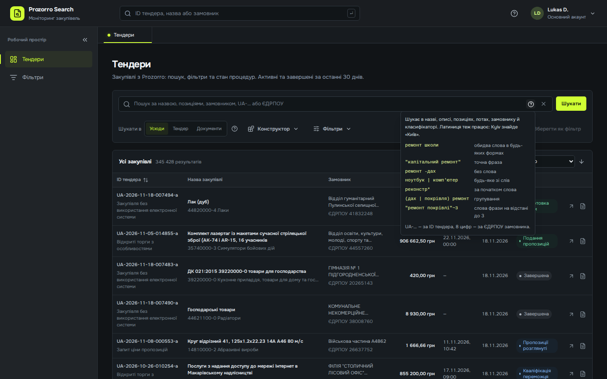

Нижче наведено всі оператори з результатами за 18.11.2026 (режим «Усюди», без фільтрів):

| Запит | Значення | Знайдено |
|---|---|---:|
| `ремонт` | слово в будь-якій формі: «ремонту», «ремонтом», «ремонтні» | 44 719 |
| `ремонт школи` | обидва слова, у будь-яких формах і будь-де в тендері | 1 142 |
| `"капітальний ремонт"` | точна фраза: саме ці слова, поруч і в цій формі | 6 267 |
| `ремонт -дах` | слово «ремонт», але без слова «дах» | 44 421 |
| `ноутбук \| комп'ютер` | будь-яке з двох слів (АБО) | 4 802 |
| `реконстр*` | за початком слова: «реконструкція», «реконструкції»… | 2 893 |
| `(дах \| покрівля) ремонт` | групування: ремонт **і** (дах **або** покрівля) | 1 347 |
| `"ремонт покрівлі"~3` | слова фрази на відстані до 3 слів одне від одного | 710 |

Як читати таблицю:

- Слова через пробіл поєднуються через **І**. Кожне нове слово звужує вибірку: «ремонт» дає 44 719, а «ремонт школи» — 1 142.
- `|` означає **АБО** і розширює вибірку. Синоніми беріть у дужки: `(дах | покрівля)`.
- `-слово` **виключає** тендери з цим словом. Мінус перед фразою виключає фразу: `-"поточний ремонт"`.
- Лапки шукають **точну форму**. `"капітальний ремонт"` не знайде «капітального ремонту». Якщо потрібні всі форми, пишіть слова без лапок.
- `*` ставиться **лише в кінці** слова. Він знаходить усі слова з таким початком, тож обирайте початок, який не зачепить зайвого: `школ*` знайде і «школа», і «шкільний».

### Морфологія, транслітерація, помилки

Система допомагає, якщо запит набрано неточно:

| Запит | Що відбувається | Знайдено |
|---|---|---:|
| `Kyiv` | латиниця шукає і кириличне написання («Київ») | 7 448 |
| `htvjyn` | запит набрано не в тій розкладці, тому система шукає «ремонт» | 44 720 |
| `ремнот` | опечатка: якщо точних збігів немає, система шукає схожі слова | 44 723 |

Коли розкладку виправлено, над таблицею з'являється повідомлення **«Показано результати для: ремонт»** і посилання **«Шукати точно як введено»**.

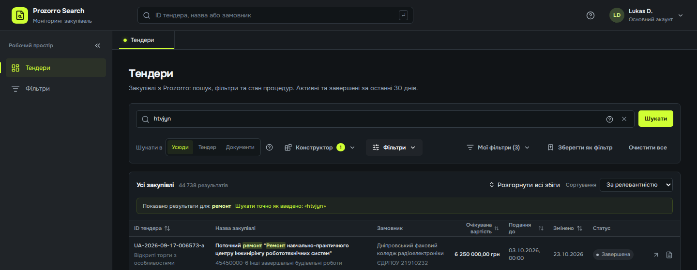

!!! warning "Збережені фільтри без підказок"

    Виправлення розкладки й пошук схожих слів працюють лише в ручному пошуку і лише тоді, коли нічого не знайдено. Збережений фільтр завжди виконує запит точно так, як його записано. Перевірте, що запит дає результати без виправлення, і лише тоді зберігайте його.

### Помилки в запиті

Якщо в запиті є синтаксична помилка, під полем з'являється пояснення з номером символу, а кнопка «Шукати» стає неактивною.

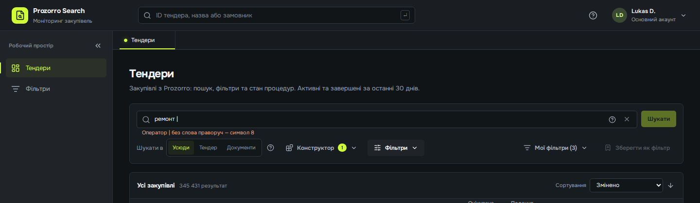

Типові помилки:

| Запит | Повідомлення |
|---|---|
| `ремонт \|` | Оператор \| без слова праворуч |
| `-дах` | Запит лише із заперечень (-) нічого не знайде |
| `(дах \| покрівля ремонт` | У ручному пошуку дужка закриється сама, але зберегти такий запит як фільтр не вийде |

Обмеження: запит займає до 4 000 символів і містить до 200 слів і фраз, з них до 50 зі `*`. У запиті має бути щонайменше 2 символи.

### Де знайдено збіг

Слова із запиту підсвічено в назві. Кнопка під рядком (**«Показати N збігів: 3 у тендері, 2 у документах»**) розгортає всі місця збігів: «Назва», «Позиція 1», «Лот 1», «Замовник», «Класифікатор», а також документи з назвою файлу й номером сторінки. Кнопка **«Розгорнути всі збіги»** над таблицею розгортає збіги одразу для всіх рядків і залишається ввімкненою, коли ви переходите на інші сторінки.

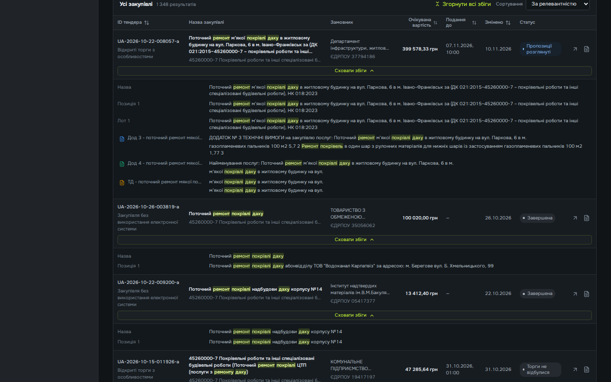

Перевіряйте збіги: так видно, чи тендер знайдено за суттю (назва, позиції), чи випадково (одна згадка в додатку до документації).

### «Шукати в»: Усюди, Тендер, Документи

| Режим | Де шукає | `покрівля` |
|---|---|---:|
| **Усюди** | дані тендера **або** текст документів | 1 239 |
| **Тендер** | лише назва, опис, позиції, лоти, замовник, класифікатор | 1 061 |
| **Документи** | лише текст документів: PDF, Word, Excel, а також скани після розпізнавання | 226 |

Усі слова запиту мають знайтися **в одному місці**: або в даних тендера, або на одній сторінці документа. Пошук у документах бачить лише вже оброблені документи. Стан обробки видно в картці тендера, на вкладці «Документи».

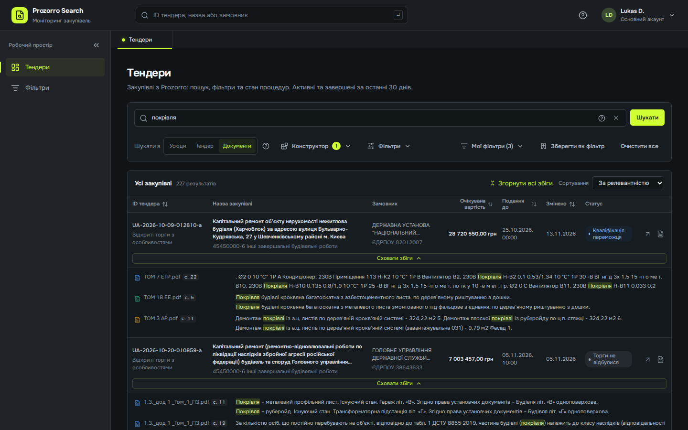

Коли потрібен режим «Документи»: для технічних деталей, яких немає в назві тендера, таких як марка обладнання, матеріал чи норматив. Наприклад, тендер «Капітальний ремонт… (Харчоблок)» знайдено за словом «покрівля» в кошторисі `ТОМ 3 АР.pdf` на с. 11.

### Конструктор запиту

Якщо не хочете писати оператори вручну, відкрийте **«Конструктор»**:

| Поле | Як працює | У запиті |
|---|---|---|
| **Усі ці слова** | кожне слово обов'язкове | `ремонт` |
| **Будь-яке з цих слів** | хоча б одне (синоніми) | `(дах \| покрівля)` |
| **Жодного з цих слів** | виключити | `-"поточний ремонт"` |
| **Точна фраза** | саме така фраза | `"капітальний ремонт"` |

У кожному полі значення пишуться через кому або з нового рядка. Кілька слів в одному пункті утворюють фразу. Рядок **«Запит:»** показує текст, який вийде. Кнопка **«Вставити в запит»** переносить його в поле пошуку. Якщо ви перед цим правили поле вручну, система попросить підтвердити заміну.

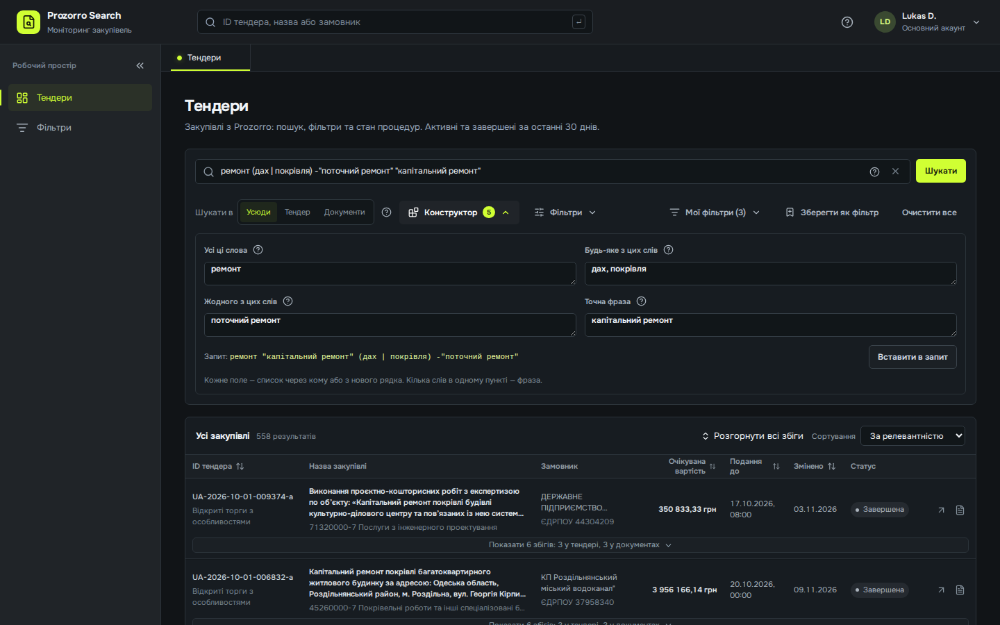

Конструктор розуміє лише прості запити. Якщо в запиті кілька груп АБО, вкладені дужки або `~N`, його можна правити тільки текстом, і конструктор про це попередить.

## 4. Фільтри каталогу

Кнопка **«Фільтри»** відкриває панель під пошуком. Число на кнопці показує, скільки фільтрів увімкнено.

| Фільтр | Значення |
|---|---|
| Група статусів | Актуальні, Активні, Архівні |
| Статус | Подання пропозицій, Аукціон, Кваліфікація, Завершена тощо |
| Тип процедури | Конкурентні, Неконкурентні, Аналіз ринку |
| Процедура | Відкриті торги, Відкриті торги з особливостями, Запит ціни пропозицій… |
| Вид закупівлі | Товари, Послуги, Роботи |
| Регіон замовника | Області та м. Київ |
| Класифікатор ДК021 | Код або група кодів, з пошуком за назвою |
| Замовник | Пошук за назвою з підказками |
| Валюта | UAH, USD, EUR… |
| Вартість від / до, ₴ | Очікувана вартість |
| Оголошено | Діапазон дат оголошення (за київським часом, межі включно) |
| Подання пропозицій до | Діапазон кінцевої дати подання (тендери без цієї дати сюди не потрапляють) |

Як фільтри поєднуються між собою:

- Кілька значень **одного** фільтра поєднуються через **АБО**: «Київська або Львівська область». Група і окремі статуси в одному фільтрі теж через АБО.
- **Різні** фільтри поєднуються між собою і з пошуком через **І**: «запит **і** актуальні **і** роботи».

### Лічильники біля варіантів

У кожному списку біля варіанта стоїть число. Воно показує, скільки тендерів залишиться, якщо вибрати цей варіант, з урахуванням запиту та всіх **інших** вибраних фільтрів. Так ще до вибору видно, на скільки звузиться вибірка.

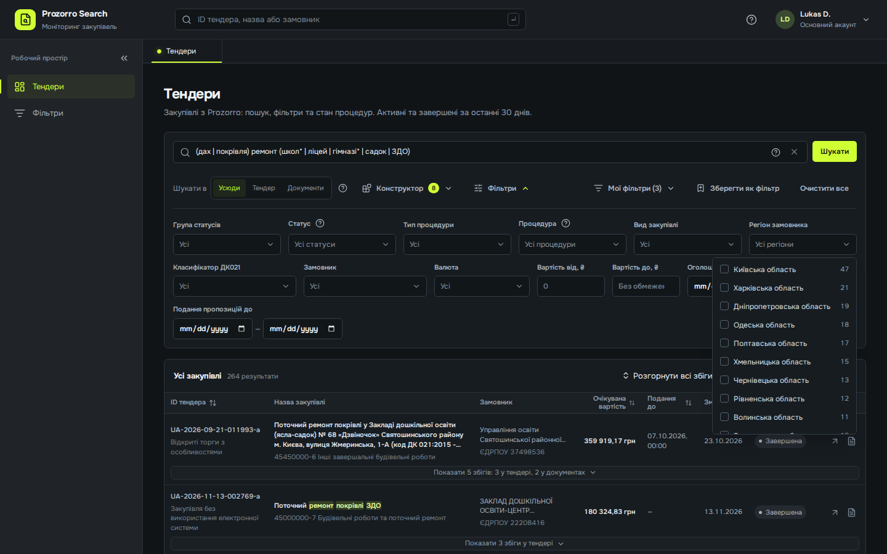

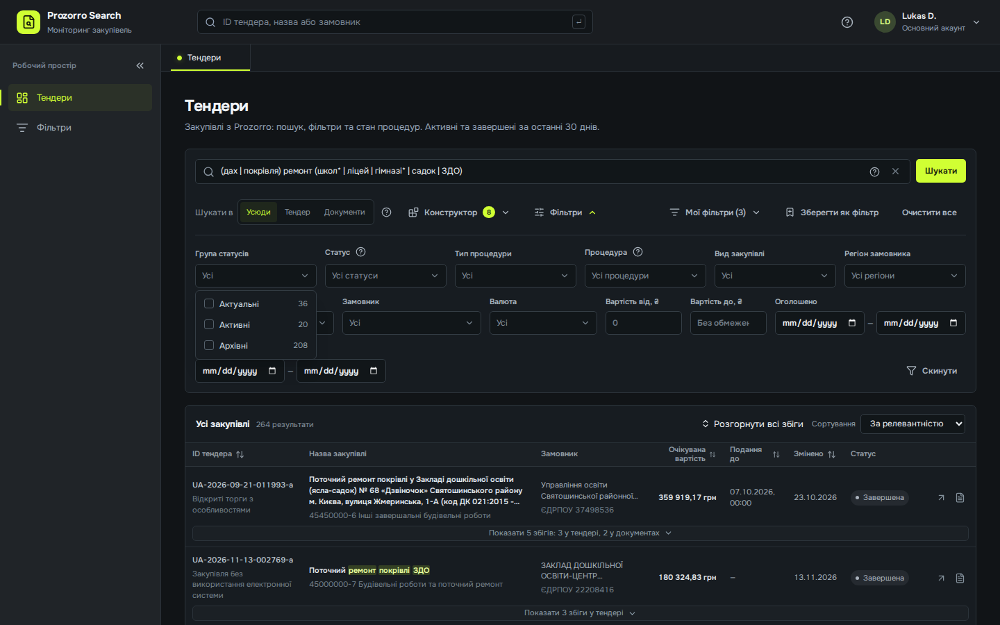

### ДК021

Почніть вводити код або назву. Біля кожного коду показано кількість тендерів. Стрілка ▸ розгортає підрівні коду. Якщо вибрати код групи, наприклад `45260000-7 Покрівельні роботи…`, у вибірку потраплять усі коди цієї групи. Тендер підходить, якщо **будь-яка** його позиція має вибраний код.

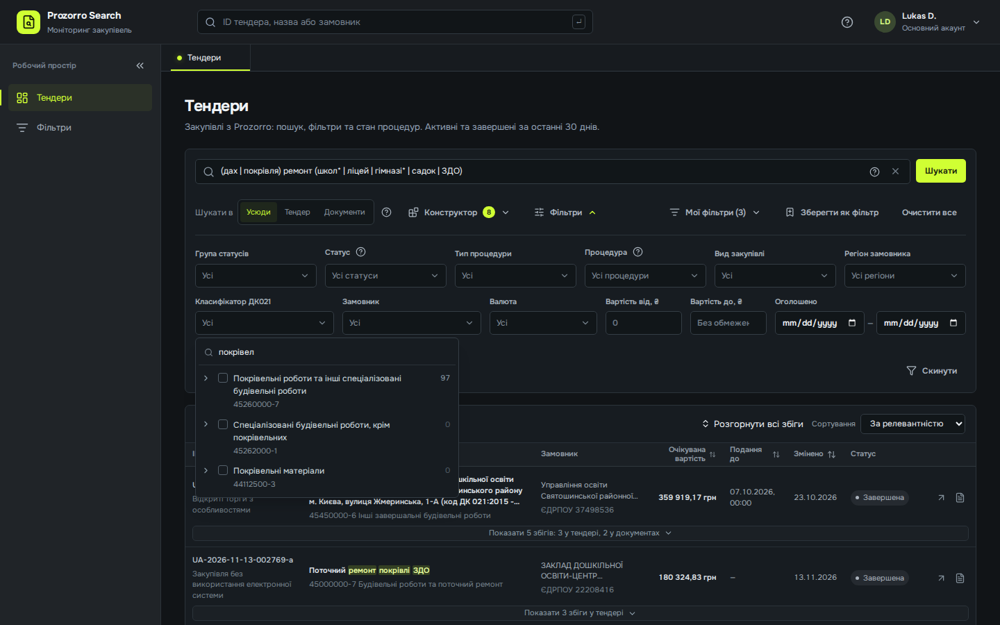

### Вибрані умови

Вибрані фільтри показано мітками під панеллю (наприклад, «Група статусів: Актуальні»). Хрестик на мітці прибирає одну умову, **«Скинути всі»** прибирає всі.

## 5. Як перевірити гіпотезу

**Гіпотеза** — це припущення, за якими словами й умовами знаходяться потрібні тендери. Перевірити її означає переконатися, що пошук знаходить потрібне (повнота) і не тягне зайвого (точність). Лише після цього пошук варто зберігати.

### Порядок роботи

1. **Сформулюйте мету одним реченням.** Наприклад: «Ремонт дахів у школах і садочках, які ще можна виграти».
2. **Почніть з широкого запиту** зі слів, якими замовники називають предмет закупівлі.
3. **Додайте синоніми** через `|` і початок слова через `*`. Подивіться, як змінилася кількість.
4. **Перегляньте перші 2–3 сторінки** з увімкненим «Розгорнути всі збіги». Позначте для себе, що зайве.
5. **Відсійте зайве** через `-слово` або `-"фраза"`. Перевірте, що разом із зайвим не зникло потрібне.
6. **Звужуйте фільтрами** (статус, вид закупівлі, ДК021, регіон, сума). Перед вибором дивіться на лічильники.
7. **Перевірте контрольні тендери.** Візьміть 2–3 тендери, які точно мають знайтися, і переконайтеся, що вони є у вибірці.
8. **Збережіть фільтр** (розділ 6).

Змінюйте за раз **одну** умову і записуйте результат. Так видно, що саме дало ефект.

### Приклад: «Ремонт дахів шкіл і садочків»

Нижче наведено реальні результати, отримані кроками зі звичайного пошуку 18.11.2026.

| Крок | Запит / фільтр | Знайдено | Висновок |
|---|---|---:|---|
| 1 | `(дах \| покрівля) ремонт` | 1 347 | Широко: тут і житлові будинки, і склади, і корпуси підприємств |
| 2 | `(дах \| покрівля) ремонт (школ* \| ліцей \| гімназі* \| садок \| ЗДО)` | 264 | Лише освітні заклади. Синоніми охоплюють школи, ліцеї, гімназії, садочки, ЗДО |
| 3 | крок 2 + `-"поточний ремонт"` | 170 | Відсіяли поточний ремонт. Підходить, якщо цікавить лише капітальний |
| 4 | крок 2 + Група статусів **Актуальні** | 36 | Лише тендери, у яких ще триває подання пропозицій або уточнення |
| 5 | крок 2 + Вид закупівлі **Роботи** | 120 | Прибрали матеріали й послуги нагляду чи проєктування |
| 6 | крок 2 + Актуальні + Роботи | 24 | Робочий список для щоденного перегляду |
| 7 | крок 2 + ДК021 `45261000-4` (покрівельні роботи) | 6 | **Надто вузько!** Замовники часто ставлять загальні коди (`45450000-6`, `45453000-7`) |
| 8 | крок 2 + Вартість від 1 000 000 ₴ | 75 | Великі об'єкти |
| 9 | крок 2 + Оголошено від 01.11.2026 | 136 | Лише свіжі оголошення |

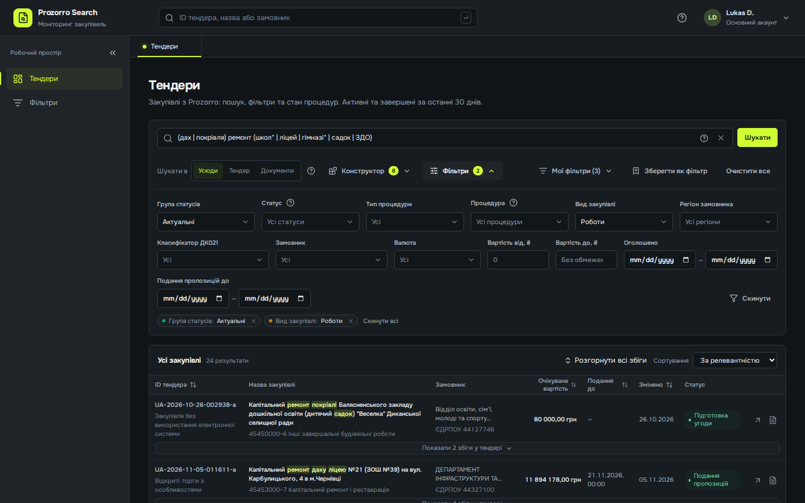

Висновки з прикладу:

- **ДК021 як єдиний критерій небезпечний.** Код `45261000-4` залишив 6 тендерів із 264, хоча за змістом підходять десятки. Перед фільтром за кодом перевірте лічильники в дереві ДК021 або візьміть ширшу групу (`45260000-7` дає 97).
- **Слова-виключення перевіряйте на вибірці.** `-"поточний ремонт"` прибрав 94 тендери. Якщо поточний ремонт теж цікавий, це виключення зайве.
- **Лічильники регіонів** одразу показують, де таких закупівель найбільше. У прикладі це Київська (47), Харківська (21), Дніпропетровська (19) та Одеська (18) області.

### Типові помилки гіпотез

| Проблема | Ознака | Що зробити |
|---|---|---|
| Запит надто вузький | Мало результатів, немає контрольних тендерів | Приберіть лапки, додайте синоніми через `\|`, `*` на початок слова |
| Запит надто широкий | Тисячі результатів, у збігах випадкові згадки | Додайте обов'язкове слово, `-виключення`, режим «Тендер» замість «Усюди» |
| Збіги лише в документах | У рядку «у документах», а в тендері нічого | Слово згадане мимохідь (у договорі, вимогах). Перевірте режим «Тендер» |
| Лапки там, де потрібні всі форми | `"ремонт покрівлі"` не знаходить «ремонту покрівлі» | Пишіть без лапок або з `~3`: `"ремонт покрівлі"~3` |
| Забагато `*` | Короткий початок слова тягне зайве (`дах*` знаходить і «даховий», і «дахування») | Робіть початок довшим або перелічіть форми через `\|` |

## 6. Збережені фільтри

**Фільтр** — це збережені запит, режим «Шукати в» і всі вибрані фільтри каталогу. Сторінка, кількість рядків і сортування не зберігаються.

### Зберегти

1. Перевірте гіпотезу в «Тендерах».
2. Натисніть **«Зберегти як фільтр»**. Кнопка активна, коли є правильний запит або хоча б один фільтр.
3. Введіть зрозумілу назву (до 80 символів, без повторів назв) і натисніть **«Зберегти»**.

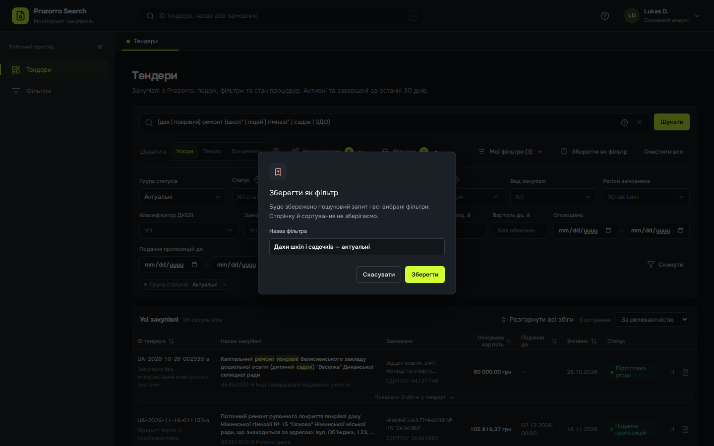

Радимо описувати в назві предмет і умову, наприклад: «Дахи шкіл і садочків — актуальні». Тоді в списку одразу видно, що робить фільтр.

### Відкрити збережений фільтр

Список **«Мої фільтри»** на сторінці «Тендери» показує збережені пошуки. Якщо вибрати фільтр, його умови підставляються в каталог.

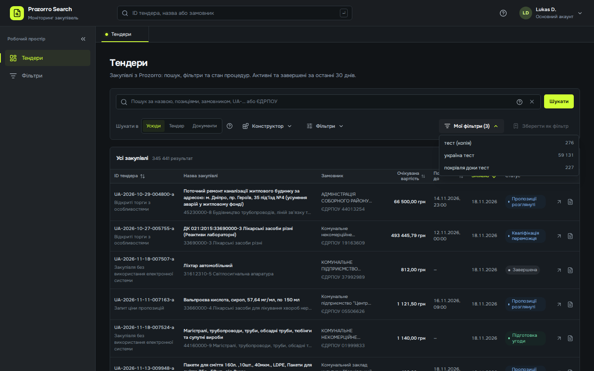

Відкритий фільтр видно в рядку над результатами: **«Фільтр «Назва»»**. Хрестик закриває фільтр, але умови залишаються в каталозі.

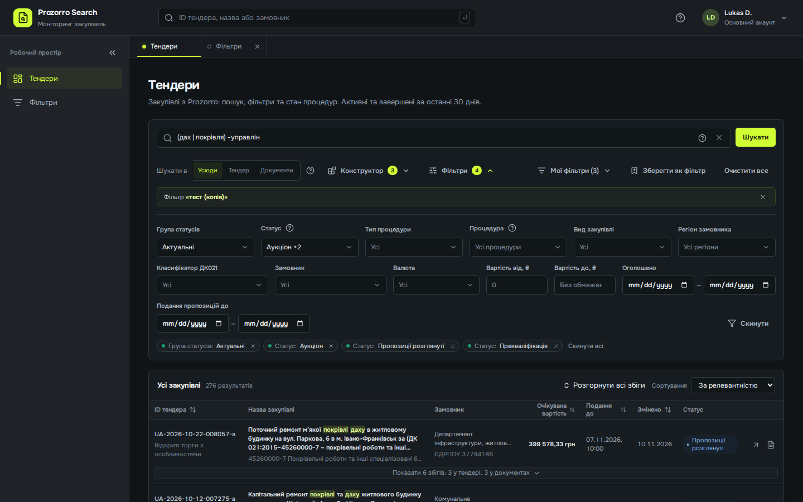

### Змінити умови фільтра

Змініть запит або фільтри в каталозі. Як тільки умови відрізняються від збережених, з'являється напис **«— умови змінено»** і дві кнопки:

- **«Оновити фільтр»** записує нові умови в цей самий фільтр;
- **«Зберегти як новий»** створює окремий фільтр, а старий залишається без змін.

Кнопки беруть запит, який зараз у полі (навіть якщо ви ще не натиснули «Шукати»), і одразу показують за ним результати.

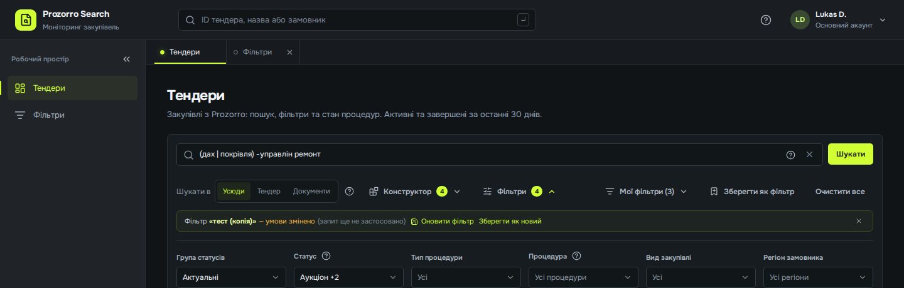

!!! tip "Як безпечно експериментувати"

    Щоб перевірити нову версію гіпотези й не зіпсувати робочий фільтр, використовуйте «Зберегти як новий». Порівняйте кількість результатів, а потім видаліть зайву версію.

### Сторінка «Фільтри»

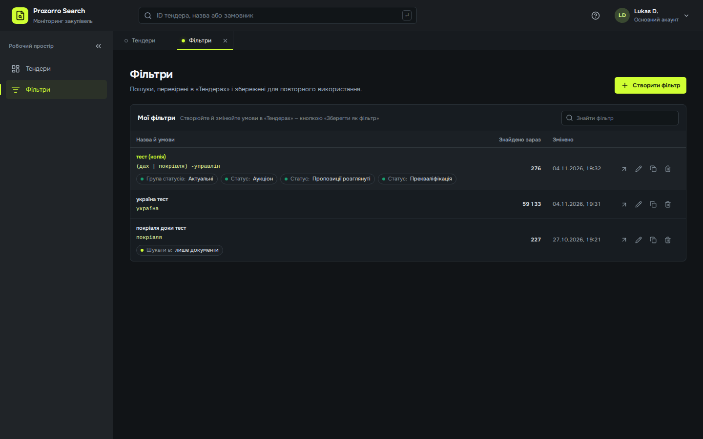

| Колонка / дія | Що означає |
|---|---|
| **Назва й умови** | Назва, текст запиту і мітки умов. Клік по назві відкриває фільтр у «Тендерах» |
| **Знайдено зараз** | Скільки тендерів фільтр знаходить на цей момент. Число збігається з кількістю в каталозі |
| **Змінено** | Дата останньої зміни умов або назви |
| ↗ | Відкрити в «Тендерах» |
| ✎ | Перейменувати |
| ⧉ | Створити копію (назва з «(копія)» і ті самі умови). Зручно для варіантів гіпотези |
| 🗑 | Видалити (з підтвердженням, скасувати не можна) |

**«Створити фільтр»** відкриває «Тендери»: умови нового фільтра завжди задаються там. Поле **«Знайти фільтр»** шукає фільтри за назвою.

Приклади фільтрів в акаунті:

| Фільтр | Умови | Знайдено зараз |
|---|---|---:|
| тест (копія) | `(дах \| покрівля) -управлін` + Актуальні + Аукціон, Пропозиції розглянуті, Прекваліфікація | 276 |
| україна тест | `україна` | 59 133 |
| покрівля доки тест | `покрівля`, Шукати в: лише документи | 227 |

«україна тест» — приклад **надто широкого** фільтра: 59 тис. результатів переглянути неможливо, і в роботі від нього користі мало.

## 7. Картка тендера

Enter на рядку або кнопка праворуч відкриває картку тендера в окремій вкладці.

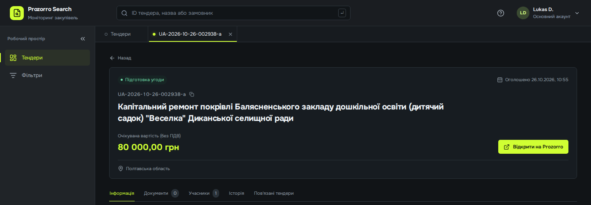

У картці є вкладки «Інформація», «Документи» (зі станом обробки кожного файлу, «N / M проіндексовано»), «Учасники», «Історія» і «Пов'язані тендери». Кнопка **«Відкрити на Prozorro»** веде на оригінал. Якщо пошук «Документи» не знаходить очікуваного, перевірте на вкладці «Документи», чи файл уже оброблено.

## 8. Шпаргалка

| Завдання | Як |
|---|---|
| Усі форми слова | `ремонт` |
| Точна фраза | `"капітальний ремонт"` |
| Синоніми | `(дах \| покрівля \| кровля)` |
| Виключити | `-проєкт`, `-"поточний ремонт"` |
| За початком | `реконстр*` |
| Слова поруч | `"ремонт покрівлі"~3` |
| Тендер за ID | `UA-2026-10-26-002938-a` |
| Усі тендери замовника | ЄДРПОУ з 8 цифр |
| Лише в документах | «Шукати в» → Документи |
| Лише ті, що можна виграти | Фільтри → Група статусів → Актуальні |
| Поділитися пошуком | Скопіювати адресу сторінки |
| Зберегти пошук | «Зберегти як фільтр» |
| Варіант гіпотези | «Зберегти як новий» або копія на сторінці «Фільтри» |
